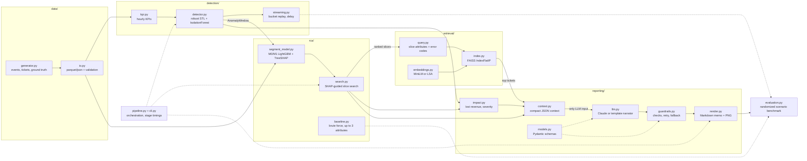

# Project Plan: Autonomous KPI Root-Cause Analysis and Executive Decision Engine via Multi-Modal ML and LLM Orchestration

| Item | Value |
|---|---|
| Domain | AIOps / Data Science and Business Intelligence |
| Team | A (Team Lead), B, C, D (placeholder names) |
| Version | 1.0, 2026-10-15 |
| Status | An AI-assisted v1 of the code exists, and this plan was drafted with AI assistance; the team reviews and adopts it in W1 |
| Related | `docs/RESEARCH.md` (all references), `README.md` (setup) |

Paths are under `src/kpi_rca/`. Stage interfaces are in `schemas.py`, config models in `config.py`, defaults in `config/default.yaml`.

---

## 1. Summary, problem and scope

**Summary.** BI dashboards alert that a KPI dropped but not why, so engineers spend hours slicing data and reading tickets. Our pipeline detects the drop, isolates the responsible customer segment, retrieves matching tickets and writes a short executive memo. Deterministic ML does all the math. The LLM only writes prose over pre-computed facts, and guardrails check every number, segment and quote.

**Problem statement.** Given hourly KPIs and support tickets, automatically:
1. detect KPI drops without hand-tuned thresholds;
2. find the smallest attribute combination that explains the excess failures;
3. retrieve customer evidence for it;
4. deliver a memo whose every number is computed deterministically, within minutes rather than hours.

| Gap | Our answer | Test |
|---|---|---|
| (a) Numbers and text sit in separate silos | Ticket search driven by the isolated segment and its error codes, limited to the anomaly window | P@5, P@10, R@10 |
| (b) Finding DE ∧ iOS ∧ PayPal without brute force | Excess-failure model plus SHAP-guided slice search | Exact match, Jaccard, top-3; slices evaluated vs brute force |
| (c) LLMs miscalculate on raw tables | Math first; the LLM sees only a compact JSON context; guardrails verify | Guardrail grounding rate (A4 is out of scope: paid API) |

How new each answer is (RESEARCH.md §3): (a) is partly covered by prior work, so the claim is the narrower one of driving ticket retrieval from the localised segment and window. (b) is largely covered by the multi-dimensional RCA literature; our contribution is the M0-offset excess framing plus SHAP-guided candidate generation, not avoiding brute force as such, and it is measured as fewer slices scored, not as a faster run (§4.3). (c) is a known problem with a known solution pattern; our contribution is the guardrails and their measurement in A4.

| In scope | Out of scope |
|---|---|
| Synthetic events and tickets with ground truth | Production deployment, streaming infrastructure |
| Batch and streaming detection | Dashboards and BI connectors |
| RCA of checkout failures; revenue impact | Automated remediation |
| Retrieval with two embedding backends | Causal proof (we localise, engineers confirm) |
| Template memo (default, free) or optional Claude memo (paid API) (`.md`, `.json`, `.png`) | Fine-tuning; non-English tickets |
| CLI, evaluation, ablations; optional semi-synthetic validation | |

- "30-second memo" means the headline and summary read in 30 seconds; summary plus root cause are capped at 200 words (`memo_max_words`). Generation time is the separate time-to-diagnosis target.
- The "2-6 h" manual-RCA figure needs a RESEARCH.md source or an "assumption" label.

---

## 2. Architecture



| # | Objective | Modules | Techniques | Measured by |
|---|---|---|---|---|
| 1 | Detect anomalies without manual thresholds | `detection/*` | Robust STL, noise-scaled MAD z-scores, IsolationForest (`contamination="auto"`), direction labels | Precision, recall, F1, delay |
| 2 | Pinpoint co-occurring attributes | `rca/*` | LightGBM M0/M1 with an `init_score` offset, TreeSHAP, EP/purity score, z-test | Exact match, Jaccard, top-3, slices evaluated |
| 3 | Retrieve tickets that match the segment | `retrieval/*` | MiniLM or LSA, FAISS `IndexFlatIP`, time filter, metadata boosts | P@5, P@10, R@10 |
| 4 | 30-second memo: impact, cause, fixes | `reporting/*` | Deterministic impact, compact context, structured outputs, guardrails, template fallback | Guardrail pass rates, A4, time-to-diagnosis |

Commands (install the `embeddings` and `dev` extras as the README describes; the uv-created venv has no pip):

```text
.venv\Scripts\python -m kpi_rca generate --config config/default.yaml --out data
.venv\Scripts\python -m kpi_rca run --data data --out outputs
.venv\Scripts\python -m kpi_rca stream --data data
.venv\Scripts\python -m kpi_rca evaluate --scenarios 20 --out outputs
.venv\Scripts\python -m pytest
```

---

## 3. Data plan

### 3.1 Generator (`data/generator.py`, `data/io.py`)
Synthetic data is the only way to score RCA, because real logs rarely record the true segment. It also gives control over segment size, magnitude and timing, keeps payment and support data private, and regenerates from a seed.

| Element | Design (`config/default.yaml`) |
|---|---|
| Rows | One checkout attempt: timestamp, country, os, device_type, payment_gateway, app_version, amount, success, error_code, latency_ms |
| Attributes | 8 countries; iOS, Android, Windows, macOS; mobile, tablet, desktop; 5 gateways; versions 5.2.1, 5.3.0 and 5.4.0 on iOS and Android, "web" on desktop |
| Traffic | 3,500 attempts per hour on average, with daily and weekly profiles and day-level noise |
| Success | Logistic model with per-attribute effects and a small daily cycle; BR always converts worse; lognormal amounts scaled by country |
| Incidents | Forced failures with a dedicated error code in one segment and time range; 3-4% of forced failures write a ticket |
| Tickets | Background themes plus decoys (PayPal refunds, declines elsewhere, app slowness, login timeouts); partly missing country and OS metadata; label `gt_incident_id` |
| Files | `transactions.parquet`, `tickets.parquet`, `ground_truth.json` (segment, times, forced failures, tickets, segment share); validated on load |

Default scenario (21 days from 2026-09-01, seed 42, about 1.8M attempts):

| Event | Definition | Required behaviour |
|---|---|---|
| INC-001 | {country: DE, os: iOS, payment_gateway: PayPal}, 4 h, `PAYPAL_SDK_TIMEOUT`, about 4% of traffic | kpi_drop; RCA returns this exact 3-way slice |
| INC-002 | {os: Android, app_version: 5.4.0}, 3 h, `APP_CRASH_ON_PAY`, about 18% of traffic | kpi_drop; RCA returns this 2-way slice |
| SURGE-US | US traffic x1.8 for 6 h (marketing email) | volume_surge, never kpi_drop |
| BR | Persistently low conversion | Never blamed |

### 3.2 Threats to validity

| Threat | Mitigation |
|---|---|
| Circularity: the generator injects the very conjunctions M1 is built to find | Red-team scenarios written by B for C; semi-synthetic validation |
| Templated tickets favour word overlap (LSA) | More paraphrases, typos and decoys; state the caveat |
| Nested attributes (desktop always means "web") let different slices select the same rows | Design review note 1 |
| Five attributes, one KPI family, modest scale | High-cardinality distractor attribute in W5; report cost vs brute force |
| 20 scenarios give wide intervals | Report 95% CIs |

### 3.3 Later validation
Types only (references in RESEARCH.md): public e-commerce logs with injected incidents (semi-synthetic), multi-dimensional RCA benchmarks from the AIOps literature, public complaint corpora for retrieval, and time-series anomaly benchmarks for detection. Run the pipeline unchanged, report the same metrics, record versions and licences, and use no personal data.

**Chosen semi-synthetic source (W8, B and D; adopted 2026-10-23):** REES46 "eCommerce behavior data from multi category store" on Kaggle (`mkechinov/ecommerce-behavior-data-from-multi-category-store`).

| Item | Detail |
|---|---|
| Content | Oct 2019-Apr 2020, one file per month (1.6-2.7 GB gzipped, about 14.7 GB in all); one row per event: `event_time, event_type, product_id, category_id, category_code, brand, price, user_id, user_session`; event types view, cart, remove_from_cart, purchase |
| Licence | "Data files © Original Authors", not an open licence; the author asks for a link to the dataset page and to REES46. Cite both; confirm the course allows it before use |
| Mapping | One checkout attempt = one session with a cart event; success = a purchase in that session; amount = purchase price. Attributes: top-level category from `category_code` (empty → "unknown"), `brand` (top 20, rest "other"), price band |
| Use | **One month only.** (1) Detection on the clean month: false kpi_drop windows per day on real traffic, and STL vs MSTL with more than 6 weeks if two months are used (design note 3). (2) Inject incidents by turning purchases into non-purchases in a chosen segment and time range; score detection and RCA as in §5 |
| Not covered | No failures, error codes or latency (a lost purchase is weaker than a failed payment); no country, OS, device, gateway or app version; **no tickets**, so retrieval is not validated here (a complaint corpus is needed for that) |
| Code change | Done 2026-10-23 (commit `c66ed09`, still under review): `dataset: external` and `rca.attributes` in the config; the adapter is in `data/adapters.py` and the runner in `scripts/validate_rees46.py`, with `config/rees46.yaml`. It is an interface change (§8), to be reviewed by A, B and C. The raw CSVs stay out of git |
| Priority | Optional; never at the cost of W3 validation or the W7 held-out run |

---

## 4. Methodology

### 4.1 Detection (`detection/`)
1. `kpi.py` aggregates hourly attempts, successes, conversion_rate, revenue and average latency (latency is context only).
2. `detector.py` decomposes conversion_rate, revenue and attempts with robust STL (period 24, seasonal smoother of 21 cycles; revenue and attempts on a log scale). "Robust STL" means statsmodels' `STL(robust=True)`, Cleveland's robustness weights, not the separate RobustSTL algorithm of Wen et al. (2019). Expected = trend + seasonal.
3. Residuals are divided by their sampling noise, so thin night hours and busy evenings compare fairly, then become robust z-scores.
4. IsolationForest on the z-scores and their 3-hour trailing means flags jointly unusual hours.
5. Direction sets the label. Attempts up, without conversion and revenue both down, is a volume_surge; otherwise conversion or revenue below expected is a kpi_drop. Flagged hours merge into `AnomalyWindow`s (at least 2 flagged buckets, 1-bucket gaps allowed).
6. `streaming.py` replays buckets using past data only (14-day history, daily refit) and records `detected_at`.

```text
y_t   = T_t + S_t + R_t,   expected_t = T_t + S_t
r_t   = (y_t - expected_t) / sigma_t     sigma_t = sqrt(p_t (1 - p_t) / n_t) for conversion,
                                          sqrt(expected attempts_t) for attempts and revenue
z_t   = (r_t - median(r)) / (1.4826 * MAD(r))
s(x)  = 2^(-E[h(x)] / c(n)), anomaly if s(x) > 0.5    (sklearn: decision_function = 0.5 - s < 0)
```

Why:
- **STL:** a fixed threshold fires every night or misses daytime drops; STL gives each hour its own expectation.
- **Noise scaling and MAD:** scaling stops thin hours from looking anomalous; MAD resists the incident hours that would inflate a standard deviation.
- **IsolationForest:** it judges KPIs jointly without labels. `"auto"` is the original paper's fixed 0.5 cut-off, not a value tuned to our data; the 2-bucket debounce removes the isolated noise hours it flags in any long series.
- **Direction labels:** a surge is anomalous but good news.
- **Weekly seasonality (measured):** each hour-of-week value of MSTL (24, 168) rests on one observation per week. The measurements behind the switch are in the comment next to `uses_mstl` in `detector.py`: false |z| > 4 on normal hours (conversion / attempts), default scenario, seeds 42 and 1, robust STL(24, seasonal 21) vs MSTL(24, 168) with windows (21, 101):

  | History | STL(24) | MSTL(24, 168) |
  |---|---|---|
  | 21 days | 5/0 and 0/1 | 39/41 and 13/20 |
  | 28 days | 0/0 and 1/1 | 9/5 and 7/12 |
  | 42 days | 2/2 and 6/7 | 5/5 and 8/8 |

  statsmodels' default MSTL windows are worse (at 21 days INC-002 disappears into the weekly component). MSTL therefore switches on only at six weeks (`mstl_min_weeks: 6.0`), where it is on a par with STL; until then the STL trend tracks the day-level weekly effect. B reproduces the comparison in W3.
- **Alternatives:** Prophet, SARIMA and autoencoders are heavier and harder to explain.
- **Caveat:** batch STL is two-sided, so batch results are retrospective; streaming gives the honest delay.

### 4.2 Excess-failure model (`rca/segment_model.py`)
M0 learns what is normal for each kind of customer (BR always fails more). M1 learns only what is different now.

```text
M0:   p0(x) = P(fail | x)                        LightGBM on the baseline period (baseline_days = 7)
M1:   logit P(fail | x) = logit p0(x) + f(x)     init_score = logit p0(x), so the trees fit only f(x)
SHAP: f(x) = phi_0 + sum_j phi_j(x)              TreeSHAP on M1 explains f, not p0
```

Features are one-hot `attribute=value` columns, so each SHAP value is readable (`country=DE`). Interaction values show which values act together.

Why:
- **The offset:** raw failure rates blame BR every day (the BR trap); the offset removes that normal level.
- **Not a "window vs baseline" classifier:** it would explain traffic-mix changes, not failures.
- **LightGBM over logistic regression:** logistic regression needs hand-made 3-way interaction terms, while trees find them. LightGBM also supports offsets and exact TreeSHAP.

### 4.3 Slice score and SHAP-guided search (`rca/search.py`, `rca/baseline.py`)

```text
excess_i = y_i - p0(x_i)                             observed minus expected failure (window rows)
EP_S     = sum_S excess_i / sum_window excess_i      share of the problem S explains      ~ recall
purity_S = sum_S excess_i / sum_S (1 - p0(x_i))      share of S's expected successes lost ~ precision
score_S  = 2 * EP_S * purity_S / (EP_S + purity_S)   harmonic mean                        ~ F1
z        = (p_w - p_b) / sqrt(p(1 - p)(1/n_w + 1/n_b))   segment failure rate, window vs baseline
```

Supersets lose purity (healthy rows dilute them) and subsets lose EP. EP alone would pick all of DE; purity alone, a handful of rows that all failed. A finding needs EP ≥ 0.10 (`min_ep`), p < 0.01 (`alpha`) and at least 30 rows.

Worked example (illustrative; total excess 600 failures):

| Slice | excess_S | Σ(1 - p0) | EP | Purity | Score |
|---|---|---|---|---|---|
| DE | 540 | 2,800 | 0.90 | 0.19 | 0.32 |
| DE ∧ PayPal | 535 | 1,500 | 0.89 | 0.36 | 0.51 |
| DE ∧ iOS ∧ PayPal | 530 | 700 | 0.88 | 0.76 | **0.82** |
| DE ∧ iOS ∧ PayPal ∧ app_version=5.3.0 | 200 | 260 | 0.33 | 0.77 | 0.47 |

iOS and PayPal raise purity sharply at almost no EP cost, while adding the version cuts EP to a third.

Search:
1. Take the failed window rows that M1 pushes up most (largest change margin f(x)) and their clearly positive SHAP features.
2. Mine frequently co-occurring feature sets of up to 4 attributes as candidates.
3. Score and test each candidate, counting evaluations.
4. Keep the best, preferring the smaller pattern on near-ties (`prune_tolerance`). Remove its excess and repeat on the residual, up to 3 findings.

Brute force (`baseline.py`) applies the same score to every combination of up to 3 attributes, standing in for manual SQL:

```text
default config (8, 4, 3, 5, 4 values):    24 +   223 +   1,008 =   1,255 slices
10 attributes x 10 values:               100 + 4,500 + 120,000 = 124,600 slices
```

These are the possible slices per round. Brute force scores every slice that has window rows, once per finding round (up to 3), so a window typically costs it about 1,800-1,900 slice evaluations.

Why:
- **vs brute force:** with the same score, the guided search should match brute force at a fraction of the evaluations. At five attributes brute force is still cheap, so the saving shows as attributes grow (A3).
- **Runtime, honestly:** the saving is in slices scored, not in wall time. Measured on the default data, the guided search scores about 50 slices in about 10-12 s (the M1 fit and TreeSHAP dominate), while vectorised brute force scores about 1,800-1,900 slices in 3-5 s. We claim far fewer evaluations, not a speed-up; at five attributes brute force is faster.
- **vs published methods** (Adtributor, iDice, HotSpot, Squeeze, RiskLoc; see RESEARCH.md): they score and search differently. Adtributor considers single dimensions only, so it cannot return the 3-way INC-001 and loses on it by design; an Adtributor baseline shows that limitation, not competitiveness. RiskLoc or Squeeze would be the fairer multi-dimensional opponent.

### 4.4 Retrieval (`retrieval/`)
- `embeddings.py`: `sentence_transformers` (all-MiniLM-L6-v2, 384 dimensions) or `lsa` (TF-IDF plus truncated SVD, 128 dimensions, fitted on the tickets). `auto` falls back to LSA with a warning.
- `query.py`: what failed, in customers' words: payment method, device and app, "payment failed at checkout" and the error codes as words, e.g., "PayPal iPhone iOS app payment failed at checkout paypal sdk timeout". Country is a score boost, not query text, because customers rarely name it.
- `index.py`: unit vectors in FAISS `IndexFlatIP`, so the inner product equals cosine and search is exact.
  - It searches from 2 h before the window to 6 h after, adds 0.05 each for a matching country and OS, and returns the top 8.
  - It also compares the window's rate of similar tickets with the baseline rate (`spike_ratio`).

Why:
- **MiniLM vs LSA:** dense embeddings match paraphrases ("payment keeps spinning" vs "timeout"); LSA runs offline and is the baseline.
- **Flat index:** exact search takes milliseconds over thousands of tickets; IVF or HNSW pay off only at millions.
- **Time filter and boosts:** they remove decoys but can hide the embedding difference (A5).

### 4.5 Reporting and guardrails (`reporting/`)

```text
lost_revenue       = sum over window hours of max(0, expected_revenue_t - revenue_t)
lost_orders        = sum over window hours of max(0, attempts_t * expected_conversion_t - successes_t)
hallucination rate = ungrounded numbers / all numbers in the narrative
```

- **`impact.py`** also computes observed vs expected conversion, revenue at risk per hour and severity (SEV1 ≥ USD 20k lost, SEV2 ≥ USD 5k, else SEV3).
- **`context.py`** builds the only LLM input, a compact JSON:
  - the impact facts, rounded as a memo would quote them, with changes and ratios pre-computed;
  - the findings and the ticket spike;
  - up to 8 ticket excerpts, which may be quoted but never count as facts.
- **`llm.py`:**
  - TemplateNarrator is the default (`provider: template`): free, offline, needs no key.
  - ClaudeNarrator is an optional, paid add-on, used only when asked for explicitly (`--narrator claude` or `provider: claude`). It calls `claude-opus-5-5` with structured outputs validated as `MemoNarrative`: headline, summary, root cause, up to 3 quotes, 1-4 actions with an owner and a P0-P2 priority, and low/medium/high confidence.
  - `auto` uses Claude when a key is set, so it is opt-in too; no default selects it (free-testing policy).
- **`guardrails.py`** checks:
  - schema and length limits;
  - numeric grounding: every number matches a context fact after normalisation ("$12.3k" = 12,345.67; "64.8%" = 0.648) within 2%, with only rounding slack for percentages;
  - segment consistency: every attribute value of the top finding is named;
  - quote grounding: quotes are verbatim excerpt substrings, ignoring case and whitespace.
- **On failure:** the narrator retries with the violations as feedback (up to 2 retries), then falls back to the template. The report JSON records provider, model, attempts, violations and fallback.

Why:
- **Scale:** the default data is about 1.8M rows, which is tens of millions of tokens as CSV and far beyond a 1M-token context. INC-001's 4-hour window alone is about 18k rows, roughly half a million tokens.
- **Deterministic checks:** structured outputs guarantee shape, not truth. Grounding checks catch wrong numbers and are cheaper, reproducible and more explainable than an LLM judge.
- **Template:** it keeps the demo and CI working offline.
- **Injection:** tickets are untrusted data and the LLM has no tools. Injected numbers, segments or quotes fail the checks.

---

## 5. Evaluation

### 5.1 Metrics

| Stage | Metric | Definition |
|---|---|---|
| Detection | Precision, recall, F1 | Detected = a kpi_drop window overlaps the incident; a kpi_drop overlapping no incident is a false positive; surges labelled kpi_drop are also counted separately. Window-overlap scoring is close to point-adjust, which inflates F1 (Kim et al., 2022), so it is always reported together with delay and false windows |
| Detection | Delay, false alarms | `detected_at` (close of the bucket that confirms the window) minus start; kpi_drop windows per day on an incident-free run |
| RCA | Exact, Jaccard, top-3 | Equal attribute=value sets; set overlap (row-level recommended); truth in the top 3 |
| RCA | Cost | `slices_evaluated` and `runtime_s` vs brute force |
| Retrieval | P@5, P@10, R@10 | Relevant = matching `gt_incident_id`; per backend |
| Guardrails | Pass rates | First attempt, after retry, fallback rate; the template must always pass |
| End-to-end | Time-to-diagnosis | Alert to memo from stage timings; LLM latency cold vs warm |

### 5.2 Protocol and baselines
- **Scenarios:** `evaluate` builds 20 random 14-day scenarios.
  - Each has 1-2 incidents on 1-3 attributes, covering 3-25% of traffic, lasting 2-6 h, at 4-9 hourly binomial sigmas of visibility.
  - Every scenario also has a benign surge and the BR effect. Scenarios where a surge overlaps an incident are reported separately (design note 3).
  - Both retrieval backends run (A1).
- **Seeds:** develop on `evaluation.seed` 7. Freeze the config with a git tag in W7, then run a new held-out seed once for the final numbers.
- **False alarms:** these need a separate incident-free run, because `evaluation.min_incidents` must be at least 1.
- **Reporting:** mean and 95% bootstrap CI, recall by visibility bin, and three repeats of each LLM run.
- **Baselines:** brute force (implemented). Optionally, one literature method in W8; Adtributor is the easiest.

### 5.3 Ablations

| ID | Comparison | Main metrics | Expected |
|---|---|---|---|
| A1 | MiniLM vs LSA | P@5, P@10, R@10 | MiniLM ≥ LSA; small gap on templated text |
| A2 | M1 with vs without the offset | RCA metrics, BR-blamed rate | BR blamed without the offset |
| A3 | Guided vs brute force, plus distractor attributes | Evaluations, runtime, exact match | Same accuracy, ≥ 10x fewer evaluations |
| A4 (paid API out of scope; free-model run proposed, §5.3) | LLM on the raw window table vs the pipeline context | Hallucination rate, lost-revenue error, segment correct, tokens, cost | Far fewer hallucinations with the context |
| A5 (optional) | Metadata boosts on vs off | Retrieval metrics | Isolates the embedding effect |

Status as built: A1, A2, A5 and the guided-vs-brute-force part of A3 run in `evaluate`. The A3 distractor attributes are **not run** yet (`metrics.json` says "not run (W5)"). A4 has only the context arm: the raw-table arm is **not implemented** (it needs its narrator variant), and A4 calls the paid API, so under the free-testing policy it is **not run** (`metrics.json` says "not run (paid API; free-testing policy; ...)"); it runs only with `--with-llm` and an API key.

**A4 is out of scope as specified.** The project is built and tested free of cost, so no paid API is called in any run, test, demo or evaluation, and no USD budget exists. The Claude code path stays (opt-in, `--with-llm`) but is never run by the team. Until the proposal below is adopted, gap (c) is argued from the design: the template memo takes every number from the deterministic context and passes the numeric-grounding guardrail at 1.00.

**Proposal (for team decision): run A4 and the LLM guardrail runs on free models.**
- **What:** add one `OpenAICompatNarrator` to `reporting/llm.py`, configured by `base_url`, `model` and the name of an environment variable holding the key (`provider: openai_compat`). The same JSON schema, guardrails, retry and template fallback apply. The template stays the default narrator; Claude stays opt-in.
- **Providers, official free tiers only** (each member signs up and uses their own key; never shared, leaked or scraped keys, and no reverse-engineered web-chat proxies):

  | Provider | Free model (check before use) | Key | Use |
  |---|---|---|---|
  | Ollama, local | Qwen / Llama / Gemma | none | Context arm, guardrail runs, demo |
  | Zhipu | GLM-4-Flash | free sign-up | Context and raw arms |
  | SiliconFlow | free Qwen / DeepSeek models | free sign-up | Context and raw arms |
  | Google Gemini | free tier | free sign-up | Raw arm (long context) |

- **Scale:** A4 is 60 calls (10 × 3 × 2) plus guardrail runs; it fits any free tier. The raw arm needs a long-context model (about 50k tokens), so Ollama is the context arm only.
- **Reproducibility:** each run records provider, model name and version, and date in provenance; free tiers change without notice, so the W7 held-out LLM run is done once and its outputs kept.
- **Tests:** a fake HTTP client only; CI and the test suite make no network calls.
- **Owners and timing if adopted:** A builds the narrator and raw-arm variant (W5), D the A4 harness (W5); A runs guardrails on the free model (W6); A4 held-out in W7. A smaller free model makes A4 a stricter test of the context arm, which is stated as a limitation, not hidden.

**A4 design (future work unless the proposal is adopted):**
- 10 held-out scenarios × 3 repeats × 2 arms = 60 calls, with the same instructions and schema.
- The raw arm gets window rows as CSV, capped near 50k tokens (about a tenth of INC-001's window); the forced sampling is itself a finding. The context arm gets the `context.py` JSON.
- Score first-attempt outputs against the deterministic fact set with the guardrail tolerance.
- D builds the harness; A builds the narrator variant.
- At list price ($4/$20 per million input/output tokens; re-check before spending), a raw call costs about $0.25 and a memo $0.06-0.10. Cap all LLM work at USD 25.

### 5.4 Success criteria (draft; confirm in W3, then freeze)

| Area | Target |
|---|---|
| Detection | Recall ≥ 0.90, precision ≥ 0.80, F1 ≥ 0.85; surge never kpi_drop; median delay ≤ 3 buckets (the 2-bucket debounce sets a floor of 2) |
| RCA | Top-3 ≥ 0.90, exact ≥ 0.75, Jaccard ≥ 0.85; BR never blamed; ≤ 10% of brute-force evaluations, with exact match within 5 points of brute force |
| Retrieval | P@5 ≥ 0.80 (MiniLM), ≥ 0.60 (LSA); R@10 reported with its cap |
| Guardrails | 100% of final memos compliant; first attempt ≥ 80%; after retries ≥ 95% |
| A4 | Out of scope (paid API); if the free-model proposal (§5.3) is adopted: context-arm hallucination ≤ 2%, raw arm reported |
| End-to-end | Median ≤ 60 s with the template (after the first model download) |

### 5.5 Results template
Fill this only from `outputs/evaluation/metrics.json` and `summary.md` of the tagged run.

| Experiment | Metric | Mean (95% CI) | Target | Met? |
|---|---|---|---|---|
| Detection (batch) | Recall; precision; F1 | 1.00; 0.62 (0.53-0.73); 0.77 (0.70-0.85) | ≥ 0.90; ≥ 0.80; ≥ 0.85 | recall yes; precision, F1 **no** |
| Detection | Surges labelled kpi_drop; false kpi_drop windows/day (incident-free) | 0.00; 0.14 | 0; report | yes |
| Detection (streaming) | F1; median delay | F1 not measured (`stream_mode: incidents`); delay 2.0 buckets, 0.97 of incidents detected | ≥ 0.85; ≤ 3 | delay yes |
| RCA guided vs brute force | Exact match; evaluation ratio | 0.86 (0.74-0.97) vs 0.94 (0.86-1.00); 0.028 (0.028-0.029) | ≥ 0.75; ≤ 0.10 | yes |
| RCA guided | Top-3; row-level Jaccard; BR blamed | 0.89 (0.77-0.97); 0.94 (0.88-0.99); 0.00 | ≥ 0.90; ≥ 0.85; 0 | top-3 **no** (31/35); others yes |
| RCA guided vs brute force | Runtime ratio | 2.63 (2.48-2.77): median 9.3 s vs 3.3 s | report | guided is slower |
| A1 MiniLM / LSA | P@5 | 0.91 (0.83-0.97) / 0.75 (0.69-0.81) | ≥ 0.80 / ≥ 0.60 | yes |
| A2 no offset | BR-blamed rate | 0.00 (found 0.69, exact 0.57 without the offset) | report | |
| A5 boosts off, MiniLM / LSA | P@5 | 0.83 / 0.70 | report | |
| A4 raw / context | Hallucination rate | not run (paid API; free-testing policy) | report / ≤ 0.02 | |
| Guardrails (template) | Pass rate | 1.00 | 1.00 | yes |
| Guardrails (Claude) | First-attempt pass | not run (paid API; free-testing policy) | ≥ 0.80 | |
| End-to-end template / Claude | Time-to-diagnosis (s) | 9.5 (8.9-10.1) compute per incident / not run | ≤ 60 / ≤ 120 | template yes |

Run: `evaluate` with the default config, 20 scenarios, development seed 7, 2026-10-15, 688 s; not yet the tagged held-out run.

**Detection precision miss (documented, not fixed).** 21 of 56 batch kpi_drop windows overlap no incident. Almost all are joint attempts-and-revenue dips (attempts z about -3 to -6) with conversion within 1% of expected, sometimes above it; a few sit at the series start (STL edge) or at midnight (day-level traffic noise). Step 5 of §4.1 labels them kpi_drop because revenue is below expected, while the benchmark counts only failure incidents. On held-out seed 101 (20 scenarios) precision is 0.43, so the miss is not a seed-7 artefact. A window-level gate (keep a kpi_drop only if pooled conversion is significantly below expected, one-sided binomial z at alpha 0.01) raised seed-101 precision to 0.89 with unchanged recall, but it redefines kpi_drop as conversion-only and needs a streaming counterpart, so it is left to the team as a decision, not changed silently.

**RCA top-3 miss.** The 4 failures each drop one true attribute: {iOS, 5.3.0} → 5.3.0; {US, iOS, 5.4.0} → {US, 5.4.0}; {Android, mobile, 5.3.0} → {Android, 5.3.0}; {Android, mobile, 5.4.0} → {Android, 5.4.0}. In the traced cases the true slice was never among the 25 mined candidates: SHAP credit for a correlated or nested value (os given app_version, mobile given Android) falls below the positive threshold (RESEARCH.md §5, threat 3). It is not the prune step. Brute force gets 3 of the 4 right; the fourth is the nested mobile/tablet case, where the 5% tie rule prefers the smaller slice. A candidate fix (score the one-attribute extensions of the chosen slice) is not implemented or measured.

---

## 6. Team plan
Slices meet only in `schemas.py`:
- B's events and `AnomalyWindow`s feed everyone.
- C's `RCAResult` feeds D's query and A's context.
- D's `RetrievalResult` feeds A's context.
- D's `evaluation.py` scores everything against the ground truth.

**Ownership rule:** you can explain every line you own, you have run and changed it, and you have tested it; "the AI wrote it" is not a viva answer. **Cover pairs** (A with D, B with C) review each other's PRs and can present each other's slice.

| Member | Owns | Delivers | Must explain |
|---|---|---|---|
| **A, Team Lead** (ticket retrieval and reporting) | `retrieval/*`, `reporting/*`; arbitrates the YAML | Adversarial guardrail tests, template memo quality, per-backend retrieval metrics, A1, A5, free LLM narrator, releases, edited report | MiniLM, LSA, cosine as inner product, FAISS flat vs IVF/HNSW, query design, why the LLM never sees raw data, context design, number normalisation, structured outputs vs guardrails, retry, fallback, impact formulas and their noise |
| **B, data and detection** | `data/*`, `detection/*`; scenario config | STL plots, STL vs MSTL rerun, detection metrics and delay, incident-free and red-team scenarios, recall by visibility | STL and the MSTL decision, noise scaling, MAD, IsolationForest path length and `"auto"`, direction labels, batch vs streaming, generator assumptions |
| **C, root-cause analysis** | `rca/*` | M0 calibration, BR check, SHAP plots, brute-force agreement, A2, A3 with a scaling curve | Log-odds and `init_score`, boosting, TreeSHAP additivity, interactions, EP and purity, z-test and multiple testing, brute-force complexity |
| **D, integration and evaluation** | `schemas.py`, `config.py`, `pipeline.py`, `cli.py`, `evaluation.py`, ablation runners, `pyproject.toml`, README, CI, docs | A3 distractor runs, bootstrap CIs, results tables and figures, held-out run, final demo | Pipeline stages and timings, interface rule, P@k, R@k and its cap, seeds, bootstrap, the demo script |

---

## 7. Timeline (10 relative weeks)
- **Dates:** map W1-W10 backwards from the deadline. If time is short, compress W8 and W10 first; never skip W3 or W7.
- **Purpose:** an AI-assisted v1 already exists, so the weeks go to understanding, validating, extending, experimenting and writing, until each member can defend every line they own.

| Week | Focus | A | B | C | D |
|---|---|---|---|---|---|
| W1 | Set up, read | Repo, CI, board, AI-use log | Run all commands; read `data/`, `detection/` | Run all; read `rca/` | Run all; read `retrieval/`, `evaluation.py` |
| W2 | Understand | Explainer + 2 tests | Explainer + 2 tests | Explainer + 2 tests | Explainer + 2 tests |
| W3 | Validate | Adversarial guardrail tests; confirm targets | STL plots, STL vs MSTL rerun, label and delay checks | M0 calibration, BR, brute-force agreement | Retrieval and label sanity |
| W4 | **Checkpoint 1** | Integration fixes | Reproduce end-to-end | Reproduce end-to-end | 20-scenario dev run, "results v0" |
| W5 | Extend | Template memo review; guardrail edge cases | Incident-free, red-team, distractor scenarios | A2, SHAP interactions | A1, A5 |
| W6 | Experiment (dev) | Guardrail runs on the template memos | Recall by visibility | A3 scaling curve | Aggregation, CIs |
| W7 | **Checkpoint 2** | Freeze (git tag) | Held-out detection | Held-out RCA | Held-out evaluation; results table |
| W8 | Optional, buffer | Figures, README | Semi-synthetic validation (with D) | Literature baseline | Semi-synthetic validation (with B) |
| W9 | Write | Edit report; slides; backup video | Data and detection chapters | RCA chapters | Retrieval and results chapters |
| W10 | Rehearse, submit | Mock viva; submit | Mock viva | Mock viva | Mock viva |

Exit criteria:
- **W4:** every member reproduces the run from a clean clone and has merged an explainer and tests.
- **W7:** a tagged release exists, every held-out number comes from scripts, and the config is frozen.

---

## 8. Collaboration
- **GitHub flow:**
  - private repo with a protected `main`; merging needs a PR, one approval from another member and green CI;
  - branches are `feat/`, `fix/`, `exp/` or `docs/`;
  - PRs stay under about 400 lines and state what, why and how it was tested.
- **CI:** GitHub Actions on `windows-latest`, Python 3.12, `dev` extra, pytest. It needs no network or key (template narrator, LSA).
- **Standards:**
  - type hints;
  - docstrings with the why and the math;
  - no magic numbers (they go in the config, which rejects unknown keys);
  - seeded randomness;
  - logging instead of print.
- **`schemas.py` changes:**
  - label the PR "interface"; A and the affected owners review it;
  - make additive changes first;
  - update call sites and tests in the same PR.
- **Rhythm and records:** a project board and a weekly 30-minute sync. Every run records config, commit and seed, and results are never edited by hand.
- **AI use and secrets:** log date, member, tool, purpose and what was verified. Keep the API key in an environment variable or a git-ignored `.env`, never in a commit.

---

## 9. Risks and mitigations

| Risk | L | I | Mitigation | Owner |
|---|---|---|---|---|
| Paid API spend by accident | L | M | Template is the default narrator; A4 runs only with `--with-llm`; a test guards both; no paid runs at all | A |
| Embedding model download fails | M | L | LSA fallback; pre-cached model; CI on LSA | D |
| "Synthetic data is unrealistic" | H | M | Threats section, red-team scenarios, W8 semi-synthetic validation | B |
| Overfitting to the default scenario | M | H | Random scenarios, held-out seed, config frozen, targets fixed in W3 | D |
| Windows and environment issues | M | M | README fixes (below) | A |
| Scope creep | H | M | Feature freeze at W7; parking-lot list | A |
| Academic integrity and AI disclosure | M | H | Institution policy, AI-use log and appendix; verify every reference at its source; write the report ourselves | All |
| Breaking `schemas.py` change | M | M | Interface-PR rule and tests | A |
| Member unavailable | M | M | Cover pairs, explainers | A |
| Results miss targets | M | M | Report honestly with failure analysis; never move targets | All |
| Ground-truth or test-seed leakage | L | H | Test that `run` works without `ground_truth.json`; separate seed lists | D, B |

Windows notes for the README:
- LightGBM needs the MSVC/OpenMP runtime.
- torch and FAISS/LightGBM may load clashing OpenMP runtimes; fix the cause rather than silencing it.
- Avoid OneDrive folders and long paths.
- Use UTF-8 console encoding and the matplotlib Agg backend.
- Guard multiprocessing with `__main__`.
- The venv has no pip.

---

## 10. Final deliverables

### 10.1 Checklist
- [ ] Tagged release, green CI, a README a newcomer can follow
- [ ] `outputs/reports/INC-001.*` and `INC-002.*`, plus `outputs/evaluation/metrics.json`, `summary.md` and `scenarios.csv` from the tagged run
- [ ] Report, slides, demo and backup video
- [ ] AI-use disclosure appendix; every reference verified (RESEARCH.md)

### 10.2 Report outline
1. **Introduction** (A): problem, MTTR motivation, objectives, contributions.
2. **Literature review** (all): KPI anomaly detection, multi-dimensional RCA, SHAP, dense retrieval, LLMs for incidents and hallucination; a gap table.
3. **Methodology** (B, C, D, A): sections 3-4 of this plan, formalised.
4. **Implementation** (A): architecture, schemas, CLI, tests, CI.
5. **Results** (D): metrics, ablations, CIs.
6. **Discussion** (all): failure analysis, threats to validity, ethics (privacy, LLM risk, AI use).
7. **Conclusion and future work** (A).

Appendices: AI-use disclosure, config, extra results, user guide.

### 10.3 Slides (12)

| # | Slide | Presenter |
|---|---|---|
| 1 | Title and team | A |
| 2 | Dashboards say "what", not "why" | A |
| 3 | Three gaps, three answers | A |
| 4 | Architecture | A |
| 5 | Generator and its traps | B |
| 6 | Detection: STL and IsolationForest | B |
| 7 | Excess-failure model | C |
| 8 | EP/purity example and search cost | C |
| 9 | Retrieval | D |
| 10 | Guarded memo | A |
| 11 | Results and ablations | D |
| 12 | Limitations, future work, Q&A | A |

### 10.4 Five-minute demo

| Time | Command | Show |
|---|---|---|
| 0:00-0:30 | - | The dashboard shows that conversion dropped, not why |
| 0:30-1:15 | `generate` (or pre-generated data) | INC-001, INC-002, SURGE-US and BR in the config |
| 1:15-2:15 | `stream` | Alerts bucket by bucket; the surge stays a volume_surge; delay |
| 2:15-3:30 | `run` | Stage timings; `INC-001.md` and PNG: segment, lost revenue, quotes, actions |
| 3:30-4:15 | `pytest -k guardrail -v` | An invented number is rejected; provenance in `INC-001.json` |
| 4:15-5:00 | - | `outputs/evaluation/summary.md`: brute-force accuracy for a fraction of the slices |

**Backup:** a recorded video and pre-generated outputs. Without network, use the template provider.

### 10.5 Viva question bank
1. **Why not give the LLM the raw data?** About 1.8M rows do not fit, LLMs miscalculate over tables, and it costs more. We did not measure this (A4 needs a paid API; the project is free); every memo number comes from the deterministic context and is checked by the grounding guardrail.
2. **Why STL?** Each hour gets its own expected value despite the daily cycle; the robust fit down-weights incident hours, and noise scaling keeps thin night hours from looking anomalous.
3. **Weekly seasonality?** We measured it. With three weeks of data, MSTL (24, 168) gave over ten times as many false extreme z-scores as STL, because each hour-of-week value rests on three points. MSTL waits for six weeks; until then the STL trend tracks the weekly level.
4. **Isn't `contamination="auto"` a hidden threshold?** It is the paper's fixed rule (score above 0.5), not tuned to our data; the incident-free run shows its cost.
5. **Why is batch detection "retrospective"?** Two-sided STL uses hours after the drop; streaming uses only the past and gives the honest delay.
6. **Why isn't the surge flagged?** More attempts without conversion and revenue both falling is labelled volume_surge, and every scenario tests it.
7. **What does `init_score` do?** It starts M1 at M0's log-odds, so the trees learn only the change.
8. **Why isn't BR blamed?** M0 already predicts BR's high failure rate, so its excess is near zero; without the offset (A2), BR is blamed.
9. **What is a SHAP value?** One feature's additive contribution to one prediction; TreeSHAP computes it exactly for trees.
10. **If SHAP explains the model, why search?** SHAP explains rows; we need one segment over many rows. SHAP proposes candidates and the score decides.
11. **Explain EP and purity.** DE has EP 0.90 but purity 0.19; the 3-way slice has 0.88 and 0.76. Like F1, the harmonic mean rewards both.
12. **Isn't brute force more accurate?** With the same score it finds the same best slice up to depth 3. At five attributes that is 1,255 slices; at 10 attributes with 10 values, 124,600 (A3).
13. **Two causes at once?** Remove the best slice's excess and search the residual, up to three findings.
14. **Why FAISS, and why normalise?** Exact search takes milliseconds, the API scales to approximate indexes, and unit vectors make inner product equal cosine.
15. **MiniLM or LSA?** MiniLM handles paraphrases; LSA relies on word co-occurrence but runs offline. A1 measures the gap.
16. **What guarantees the memo's numbers?** Deterministic computation, context-only input, numeric grounding, retry, then template fallback.
17. **Prompt injection in tickets?** Tickets are untrusted data, the LLM has no tools, and numbers found only in tickets never count as facts.
18. **Aren't you fitting your own generator?** Partly, and we say so; random, red-team and semi-synthetic scenarios and a held-out seed reduce the risk.
19. **Is it causal?** No. We localise where excess failures concentrate; engineers confirm the cause.
20. **How did you use AI?** The v1 code and this plan were AI-assisted; we logged use, verified and tested the code, and wrote the report ourselves.

---

## Design review notes
These notes concern the contract and the code written so far:
- `schemas.py`, `config.py` and `config/default.yaml`;
- `data/` and `detection/detector.py`;
- `reporting/` (models, guardrails, impact, context);
- `retrieval/` (embeddings, query).

Notes on modules not yet written are conditional. Nothing was changed silently; the Team Lead decides.

1. **Equivalent slices.** App versions ship on both iOS and Android, so INC-002 is unambiguous. Desktop rows are nested, though:
   - `device_type=desktop` and `app_version=web` select the same rows;
   - `os=Windows` implies both.

   A random scenario on such a segment can fail exact match while finding the identical rows. Fix this by scoring on row sets, or by keeping redundant pairs out of scenario sampling.
2. **Spurious findings.** Brute force tests up to 1,255 slices at α = 0.01, so about a dozen could pass by chance even with nothing broken. If `min_ep` is measured against the residual, a noise slice can become a second finding once the true cause is removed. Count extra findings in single-incident scenarios, consider α / `slices_evaluated`, and apply the same rule in both searches.
3. **Detection.**
   - **Surge overlap:** an incident that overlaps a surge is labelled volume_surge whenever revenue still rises, so it never reaches RCA. The rule is right for mix-shift surges (a BR surge lowers aggregate conversion). Either keep surges and incidents apart in the sampler and report overlaps separately, or run RCA on surge windows too and promote any window with a significant finding.
   - **Dormant MSTL:** MSTL never runs by default (21-day batch, 14-day benchmark, 14-day stream history), so only STL is benchmarked. The coder's comparison still favoured STL at 42 days (14 vs 6 false |z| > 4 hours over two seeds), so re-measure before relying on the 6-week switch.
   - **False alarms:** `evaluation.min_incidents` must be at least 1, so false alarms need a separate incident-free run.
4. **Lost-revenue truth.** `ground_truth.json` has no lost amount, and `forced_failures` includes rows that would have failed anyway (about 10-15%). Emit true lost orders and their summed `amount` so `impact.py` can be scored. Expect noise: order values are lognormal. By a rough estimate, INC-001's revenue-based loss (about USD 37k) has a standard error near a quarter of its size. Lost orders times the segment's baseline order value would be about three times steadier.
5. **LLM settings (for `llm.py`).** `models.py`, `guardrails.py` and `context.py` already keep limits out of the schema, normalise numbers and pre-compute changes and ratios. Remaining:
   - `LLMConfig` has no `effort` field, so Opus 5.5 (thinking always on) runs at the API default, medium, unlogged. Add the field and log it. Never send `thinking: {type: "disabled"}`, which this model rejects with a 400.
   - `server_side_fallback` is presumably the beta `fallbacks` parameter (Claude API and Claude Platform on AWS only). It can answer a declined request with another model, so record the response's `model` in provenance and in A4.
   - Treat `refusal` and `max_tokens` stops, and timeouts, as failed attempts. Thinking plus a 16,000-token cap can outlast `timeout_s` = 120, so check the timeout or stream.
   - A new schema is compiled on first use and then cached for 24 h, so report cold and warm latency.
6. **Retrieval metrics.**
   - `top_k` is 8, so P@10 and R@10 need the evaluation to retrieve at least 10.
   - R@10 is capped at 10/|relevant|. INC-001 should produce about 27 tickets, so its R@10 cannot exceed about 0.37. Report the cap or R-precision.
   - Run A5, because the boosts blur the MiniLM vs LSA comparison.
7. **A4 scoring.** For the raw arm, "the number appears in the input" proves nothing. Score both arms against the fact set, using first attempts only.
8. **Brute force is stronger than manual SQL** if it uses p0. An optional raw-rate variant would show the BR trap a human falls into.
